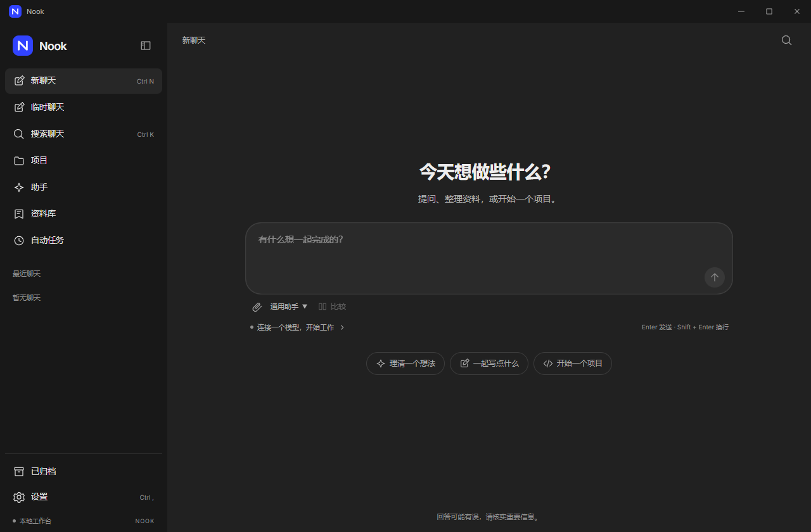

# Nook

本地 AI 工作台。连接模型，处理资料，推进项目。

> 开发中的 Windows 桌面应用，尚未发布正式版本。界面与品牌正在更新。



## 一个窗口，完成日常工作

| 工作 | 可以做什么 |
| --- | --- |
| 对话 | 连接多个模型，比较回复，编辑消息，管理上下文摘要，沿分支继续讨论 |
| 资料 | 导入文档与图片，阅读 PDF 原件，检索资料集与引用 |
| 项目 | 编辑代码、预览 HTML 草稿、管理分支与独立工作树、审阅改动、使用终端 |
| 助手 | 保存工作指令与提示模板，连接 MCP，加载本地技能 |
| 记忆 | 显式管理全局或项目记忆，随时编辑、停用或删除 |
| 自动任务 | 安排一次、周期或 Cron 任务，查看执行结果 |
| 浏览器 | 在独立临时会话中浏览网页，返回／前进、停止／重试，切回聊天保留草稿 |

支持 OpenAI 兼容接口、Responses、Anthropic、Gemini、Azure 和 Ollama。文件修改与命令执行会展示审批内容。

## 开始使用

目前请从源码运行。需要 Node.js 24、pnpm 10.32.1；项目操作另需 Git，Windows 终端使用 PowerShell。

```sh
pnpm install
pnpm exec install-electron
pnpm dev
```

打开「设置 → 模型连接」，添加服务地址、凭据和模型，然后创建聊天。使用本地 Ollama 时，需要先启动对应服务。

## 数据归你管理

聊天、草稿和项目配置保存在本机。模型请求会发送至你选择的服务；本地保存不等于离线推理。凭据使用系统加密存储，完整备份不包含密钥。

临时聊天在退出应用后清除，不进入聊天历史或备份；主动导出和工具操作产生的文件仍会保留。

## 文档

- [模型连接](docs/MODEL-CONNECTIONS.md) · [附件](docs/ATTACHMENTS.md) · [资料库](docs/KNOWLEDGE.md)
- [PDF 原件与阅读](docs/PDF-PREVIEW.md) · [本地恢复副本](docs/LOCAL-RECOVERY.md)
- [内容阅读与代码换行](docs/RICH-CONTENT.md) · [工具记录](docs/TOOL-ACTIVITIES.md) · [记忆](docs/MEMORIES.md) · [临时聊天](docs/TEMPORARY-CHATS.md)
- [快速聊天](docs/QUICK-CHAT.md) · [桌面入口](docs/DESKTOP-INTEGRATION.md)
- [项目](docs/PROJECTS.md) · [HTML 预览](docs/PROJECT-PREVIEW.md) · [对话分支](docs/CONVERSATION-BRANCHES.md) · [模型比较](docs/MODEL-COMPARISON.md)
- [会话上下文与摘要](docs/CONTEXT-SUMMARIES.md)
- [独立项目工作树](docs/PROJECT-WORKTREES.md)
- [助手](docs/ASSISTANTS.md) · [自动任务](docs/AUTOMATIONS.md) · [插件](docs/PLUGINS.md)
- [备份与恢复](docs/BACKUPS.md) · [快捷键](docs/COMMANDS.md) · [发布状态](docs/RELEASE.md)

## 开发与验证

```sh
pnpm check
pnpm test:coverage
pnpm build
```

Windows 桌面验证：`pnpm test:desktop`，需要 Git、PowerShell 和 Google Chrome。生成 Windows 安装包：`pnpm package:win`。

界面按照指定的桌面设计资料逐项调整，目前尚未完整还原。已采用明暗主题与参考设计变量；UI 字体使用 OFL 许可的 Inter 和系统中文字体。进度与差异见 [设计对照](docs/DESIGN-ALIGNMENT.md)。内部兼容标识及历史验证记录仍保留原名。

## 开源许可

基于开源项目独立开发，保留原始许可证与来源声明。详见 [LICENSE](LICENSE)、[COPYING](COPYING) 和 [第三方许可说明](docs/LICENSES.md)。
