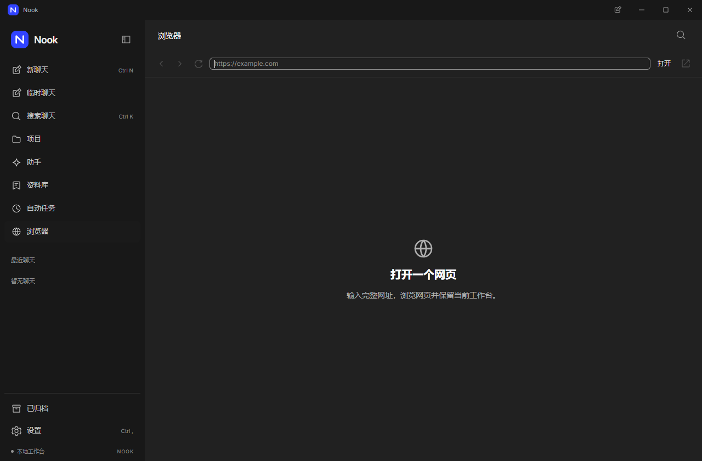

# 浏览器

在侧栏选择「浏览器」，输入完整的 HTTP 或 HTTPS 网址，然后选择「打开」。网页留在独立面板中，切回聊天时保留当前网页和聊天草稿。调整窗口和缩放后，侧栏保持当前选中项可见。

- 使用返回、前进、刷新或停止按钮；加载失败后可以重试。
- 按 `Ctrl L` 或 `F6` 回到地址栏；选择「进入网页」把键盘焦点交给网页。
- 需要下载、授权网站权限或打开新窗口时，选择「在系统浏览器中打开」。

网页可以运行自身脚本，但不能访问工作台桥接或 Node。面板采用独立的临时会话，应用退出后不恢复网站 Cookie、本地存储或浏览历史。重新加载主工作台也会释放网页会话，聊天草稿仍然保留；刷新网页本身继续使用当前会话。它与聊天的临时会话是不同功能；网站仍按其自身规则处理访问数据。

当前提供一个网页面板。标签页、保存历史、网站权限授权、内置下载和浏览器自动化尚未实现。公网服务、物理输入、辅助技术、其他平台和最终安装包需要独立验收。

界面复用指定设计资料中的共享控件与主题。资料中浏览器样式只包含部分局部规则，地址栏和页面布局采用项目实现，不能据此声称完整还原。

源码专项九组及 15 张逐张检查的原始截图见[验证记录](../verification/native-view-lifecycle-review-result.json)。网页视图与面板壳保留为不同原图；该记录不替代安装包或全部页面验收。

浏览器也已纳入通过的 262 组完整源码桌面回归，覆盖双窗口及主界面重载。[完整源码记录](../verification/native-view-lifecycle-review-result.json)

