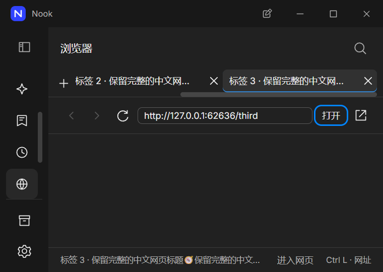

# 浏览器

在侧栏选择「浏览器」，输入完整的 HTTP 或 HTTPS 网址，然后选择「打开」。网页留在独立面板中，切回聊天时保留当前网页和聊天草稿。调整窗口和缩放后，侧栏保持当前选中项可见。

- 使用返回、前进、刷新或停止按钮；加载失败后可以重试。
- 选择加号或按 `Ctrl T` 新建标签，最多打开 16 页。每页保留自己的历史、未提交地址和加载状态；只有选中页显示。
- 按 `Ctrl Tab`／`Ctrl Shift Tab` 切换，`Ctrl W` 关闭当前页。聚焦标签后可用方向键、`Home`／`End` 切换，`Delete` 关闭。
- 按 `Ctrl L` 或 `F6` 回到地址栏；选择「进入网页」把键盘焦点交给网页。
- 需要下载、授权网站权限或打开新窗口时，选择「在系统浏览器中打开」。

网页可以运行自身脚本，但不能访问工作台桥接或 Node。标签共享独立的临时会话，同站点可共享 Cookie 和本地存储。关闭最后一页会释放会话并打开新的空白页；重新加载主工作台或退出应用也会释放全部标签，聊天草稿仍然保留。刷新网页本身继续使用当前会话。它与聊天的临时会话是不同功能；网站仍按其自身规则处理访问数据。

当前提供临时多标签浏览器。保存标签／历史、网站权限授权、内置下载和浏览器自动化尚未实现。公网服务、物理输入、辅助技术、其他平台和最终安装包需要独立验收。

界面复用指定设计资料中的共享控件与主题。资料中浏览器样式只包含部分局部规则，地址栏和页面布局采用项目实现，不能据此声称完整还原。

多标签源码专项 14 组通过，31 张原始截图已逐张检查；包含后台失败／关闭、独立地址草稿、共享临时存储、原生快捷键、最后一页清理、全部标签随工作台重载释放，以及浅／深主题的 100%／125%／150% 缩放。网页视图与面板壳保留为不同原图；记录不替代安装包或全部页面验收。[验证记录](../verification/browser-tabs-review-result.json)

此前单页浏览器已纳入 262 组完整源码桌面回归；该历史记录不证明本轮多标签的新安装包。[历史源码记录](../verification/native-view-lifecycle-review-result.json)

本轮多标签随后纳入通过的 267 组完整源码桌面回归，38 次正常退出。完整轮原始截图另行归档，本轮逐张视觉检查仅针对上述专项的 31 张原图。[本轮源码记录](../verification/browser-tabs-review-result.json)

