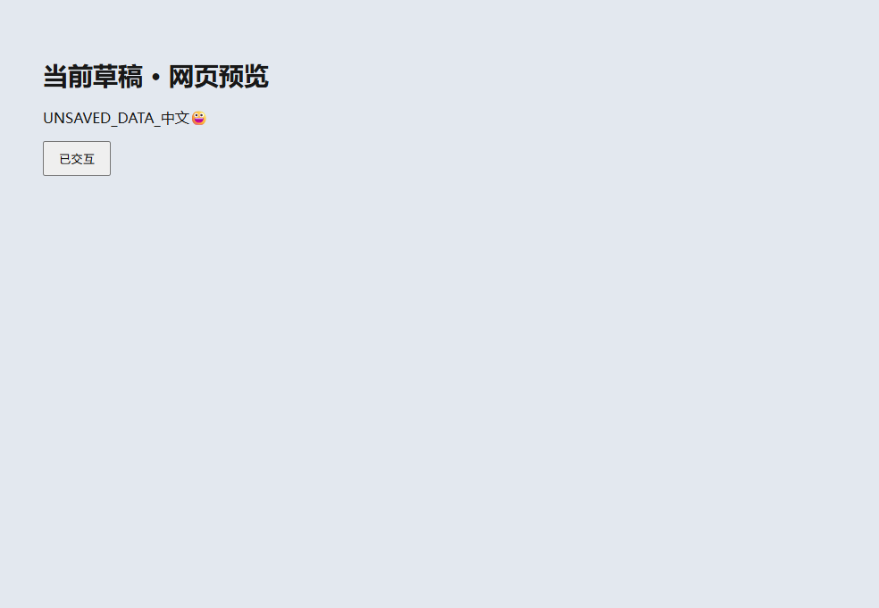
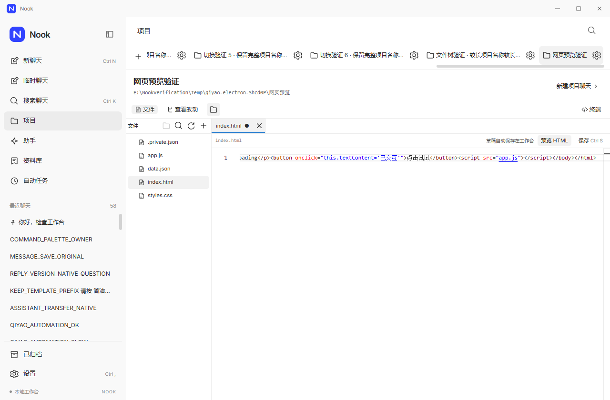
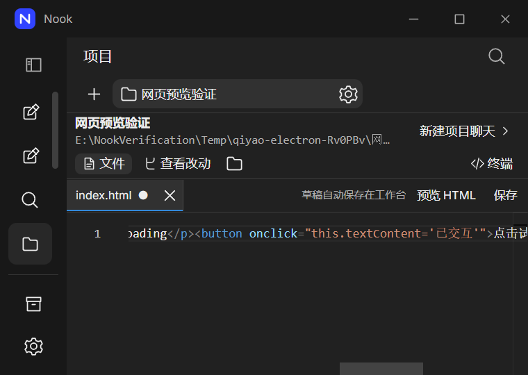

# 项目 HTML 预览

在项目编辑器打开 `.html` 或 `.htm` 文件后，点击“并排预览”可在编辑器旁运行当前草稿，点击“预览 HTML”则使用独立窗口。无需先覆盖磁盘文件；清空后的草稿会显示空白页面，不会偷偷回退到原文件。

并排模式支持拖动分隔条，也支持聚焦分隔条后使用方向键、Home 和 End 调整比例。窄且矮的窗口改为“编辑代码／查看预览”切换，保留编辑器和预览会话；修改后点击“刷新”更新快照。打开设置等弹窗时预览暂时隐藏，关闭弹窗后恢复；在预览内按 Esc 返回工作台。预览崩溃后可显式重试。

预览支持浏览器原生 HTML、CSS、JavaScript 和 JavaScript 模块。相对路径以该 HTML 所在目录为基准，根路径以选中的项目目录为基准。当前源码会同时快照其他打开标签中尚未保存的 HTML、CSS、JS／MJS、JSON 和 SVG，空草稿也会覆盖对应的磁盘版本；图片、字体及没有改动的文件继续从项目读取。每次最多带入 32 个关联草稿，各文件沿用 256,000 字符上限，合计最多 2,000,000 字符；磁盘资源上限为 8 MiB。此多文件改动已通过专项验证，现有分发候选仍是单文件草稿实现。

编辑后再次点击预览，会关闭旧窗口并打开新内容。每次预览使用新的临时会话，页面存储不会跨预览保留；关闭、移除项目、更改项目目录、恢复工作台或退出时会清理预览。草稿仍由原有编辑器保存机制管理。

预览不提供工作台桥接或 Node 权限，不开放外部 HTTP 资源、窗口跳转、弹出窗口、下载或设备权限。项目外的路径、隐藏文件／目录和不支持的资源类型会被拒绝。本地页面仍会执行 JavaScript，应将它看作可运行内容；这不是操作系统级恶意软件分析环境。

需要开发服务器、远端 API、CDN、npm 构建、React／JSX 或 TypeScript 编译的项目，仍须使用自己的构建与运行流程。通用生成产物编辑、浏览器导航和文档版式预览仍在后续范围内。

## 验证

并排预览通过类型检查、构建及 29 项资源／窗口／嵌入视图测试。真实 Electron 专项通过 9 组检查，正常退出耗时 3062ms，包括原有独立窗口检查和新增 4 组并排检查。最小窗口在 150% 缩放下的预览高度从失败时约 10 CSS 像素恢复至约 124 CSS 像素；切换编辑界面后保持同一预览会话。浅色和暗色 100%／125%／150% 的八张截图已逐张检查，但主窗口与原生预览内容是分别捕获的，不是完整原生窗口合成证据。详见[并排验证记录](../verification/docked-preview-review.md)。完整回归、分发及新增入口的全部生命周期验收仍未完成。

最新多文件改动通过类型、构建、19 项资源／窗口测试及实际桌面五组专项，正常退出 3781ms。实际编辑 HTML、CSS、JavaScript 和 JSON 后，预览使用各自草稿，磁盘文件保持原文；明暗／窄窗 150% 截图已检查，外部 HTTP 请求为零。两次测试准备／清理失败及修正保留于[多文件验证记录](../verification/preview-drafts-review-result.json)。这不代表新版完整回归、分发或托管验证已完成。

`7c81e33` 的全量组件回归为 77 个文件、802 项测试通过；语句覆盖率 97.07%、分支 94.62%。覆盖统计针对契约与桌面服务模块，不包含渲染界面，不能据此推断全部 UI 已验收。

以下为此前单文件实现的验证历史：

资源与窗口生命周期的 17 项专项测试，以及全量 798 项组件测试通过。实际 Electron 专项的 5 组检查覆盖当前草稿、项目内 CSS／脚本／JSON、脚本交互、外部 HTTP 拦截、隐藏文件与工作台来源隔离、独立存储、空草稿、关闭与项目移除，以及浅色／深色最小窗口 150% 缩放。该专项正常退出，原项目文件未改变，见[运行记录](../verification/project-preview-result.json)。发布策略拒绝缺失、部分通过或发生外部 HTTP 请求的预览记录，并要求完整桌面套件包含记忆和预览检查。

完整源码 223 项 Electron 回归也已通过，包含上述 5 组预览检查，无运行时错误并正常退出；首次完整运行失败及后续重放记录保留在[本批证据](../verification/project-preview-review-result.json)。测试使用 DOM 粘贴事件和脚本操作预览内容，不代表物理剪贴板、辅助技术、所有浏览器 API 或完整沙箱安全审计。同一应用体的安装版／便携版与托管验证仍以[发布状态](RELEASE.md)为准。

